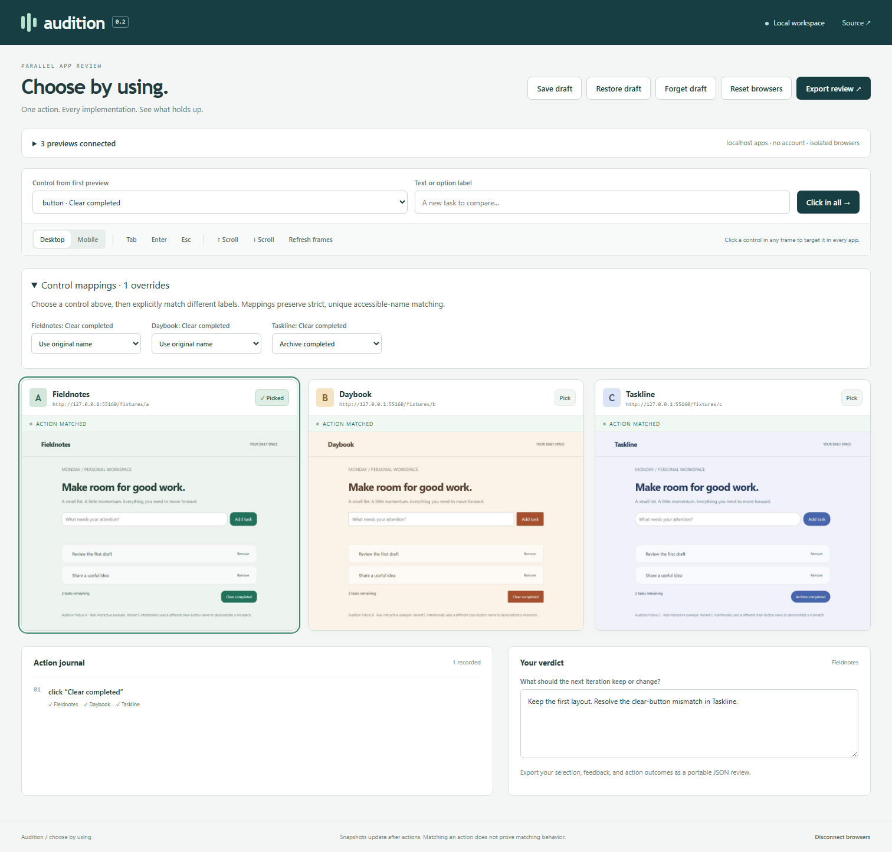

# Audition

**One action. Every implementation. Choose by using.**

Audition lets you operate two or three local web apps side by side. Fill a named field, click a button, or switch to mobile once. Each app gets the equivalent action in an isolated Chromium browser. Missing or ambiguous controls are reported honestly, so a mismatch becomes useful feedback.



[Project page](https://alfonza1.github.io/audition/) · [Architecture](docs/architecture.md) · [Contributing](CONTRIBUTING.md) · [Security](SECURITY.md)

## Start in a few minutes

Requires **Node.js 22.12+**, npm, and a Chromium download (approximately 330 MB on Windows). No API keys, account, cloud service, or model required.

```powershell
git clone https://github.com/alfonza1/audition.git
cd audition
npm ci
npx playwright install chromium
npm run dev
```

Open **http://127.0.0.1:4321** and select **Open the live demo**. On Linux, use `npx playwright install --with-deps chromium` if browser system libraries are missing. Subsequent launches can use `npm start`; rebuild after source changes with `npm run build`.

## Try a real comparison

1. Open the three-app demo, or enter two or three running localhost app URLs.
2. Select **textbox · Task title**, type a task, and press **Fill all**.
3. Select **button · Add task** and press **Click in all**. Every app gets the new task.
4. Select **button · Clear completed**. The first two examples match; Taskline deliberately calls it **Archive completed**, so Audition records a mismatch.
5. Switch to **Mobile**, choose your preferred implementation, and export a review with your feedback.

These are real browser actions, not coordinated mock animations. The fixtures are deliberately small example apps and are labeled as such.

## Compare your own branches

Start each branch's dev server on a different port, then connect their URLs in Audition. The apps can share accessible names for equivalent controls, or use explicit per-preview mappings:

```tsx
<label htmlFor="title">Task title</label>
<input id="title" />
<button>Add task</button>
```

The matching key is an exact **role + accessible name**. One match is required. Zero matches or duplicate names are reported, never silently replaced with coordinate clicks on other apps. You can also click a named control inside any screenshot: Audition discovers its semantic target and applies it across the previews. Clicking an input selects it for the text composer.

App navigation through matched links works within supported localhost origins. Each preview has independent cookies and local storage; existing browser profiles and sign-in sessions are never used.

## What works in 0.2

- Two or three isolated local app previews, captured after each action.
- Named buttons, links, textboxes, checkboxes, radios, switches, and select controls.
- Fill, click, select, Tab, Enter, Escape, and synchronized scrolling.
- Desktop (1000×720) and mobile (390×760) viewports.
- Explicit per-preview match/mismatch outcomes and a 100-event journal.
- Browser-state reset, variant selection, feedback, and JSON review export.
- Real local fixture apps for an immediate demo.

## Map different labels and resume a review

Select **button · Clear completed**, open **Control mappings**, and set Taskline to **Archive completed**. The next click uses that exact control in Taskline and the original name elsewhere. Only controls with the same role can be mapped; missing or duplicate matches still fail visibly. Mappings appear in exported reviews and survive browser reset.

**Save draft** stores the connected URLs, notes, selected variant and mappings in this browser's local storage. **Restore draft** validates the URLs and mappings again, opens fresh browser contexts, and restores the review notes. It does not replay actions, restore cookies or recover database state. **Forget draft** removes the saved copy. Drafts are opt-in and contain local URLs/notes, but never the typed action journal. They persist across server restarts when the controller URL/port stays the same.

A failed connection preserves the current working previews and journal. A disconnected Chromium process can be recovered with **Reset browsers**. Concurrent requests return HTTP 409 instead of interleaving mutations; refresh a second tab after the active action finishes.

## Deliberate boundaries

- **Matching an action is not an assertion of equivalent behavior.** Inspect the resulting screens.
- **Reset browsers does not reset your database.** Use disposable app data and your application's own seed/reset procedure. Audition closes contexts and creates clean ones.
- Snapshots update after actions or **Refresh frames**. This is not live video.
- Standard, named HTML controls in the top-level document are supported. Canvas controls, drag/drop, rich editors, iframe contents, and complex shadow-DOM widgets are outside the initial scope. Screenshot target discovery supports a subset of accessible-name computation; the composer provides the same explicit matching contract.
- Only loopback HTTP(S) targets are accepted. External resources and all WebSockets are blocked. Apps requiring remote APIs, CDN assets, or WebSocket data need a local test setup; Vite HMR is consequently unavailable inside previews.
- Browser dialogs are dismissed, popups closed, and downloads disabled.
- The app is a single local review workspace. Multiple tabs share that session. There is no remote collaboration server.
- Exports contain your entered text and local URLs. Review them before sharing. Screenshots may show application data.

## Development and checks

```powershell
npm run typecheck
npm run lint
npm test
npm run build
npm run test:e2e
```

`test:e2e` starts ephemeral local servers and headless browsers, verifies an independently served app plus fixtures, exercises desktop/mobile UI, checks export and network boundaries, and writes `docs/images/workspace.png`. Transient captures go in ignored `artifacts/`.

Change the control port with `$env:PORT = '4325'` in PowerShell before `npm start`. The server always binds to `127.0.0.1`.

## Why this exists

Parallel coding agents make it easy to produce competing implementations. Comparing them through separate tabs, terminal logs, and code diffs makes the product differences harder to see. Audition focuses on the moment you need to decide which experience to keep. It works with apps produced by any agent—or by people.

Worktree managers handle development orchestration; BrowserSync synchronizes browsing; Playwright supplies browser primitives. Audition combines a bounded semantic matching contract, independent app contexts, visible mismatches, and a portable review artifact.

## Roadmap

Saved journeys, application-provided reset hooks, and optional tightly scoped network allowlists. No automatic source merging is promised.

MIT licensed. See [CHANGELOG](CHANGELOG.md) for versioned release notes.
