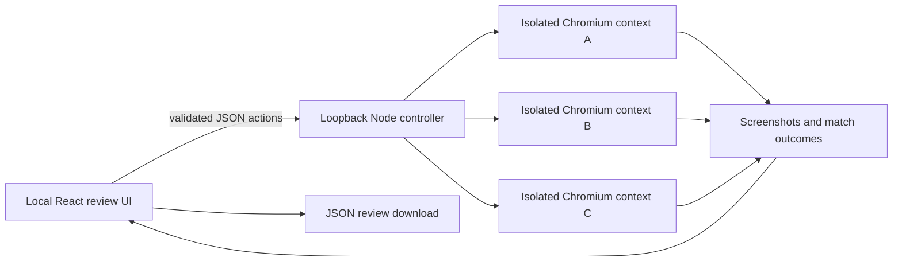

# Architecture

Audition is a single-user local application with a React frontend and a Node HTTP controller. Playwright runs headless Chromium; there are no iframes pretending to synchronize unrelated apps.

## Boundaries

`server/validation.mjs` owns limits, accepted URLs, roles, and action validation. `server/engine.mjs` owns contexts, request interception, target discovery, action outcomes, and reports. `server/index.mjs` owns HTTP routing, body limits, same-origin checks, static assets, and shutdown. `src/main.tsx` owns the comparison workflow.

Actions execute concurrently across lanes, but mutations are serialized at the workspace level. If an action is already running, another mutation is rejected rather than queued against unknown state. Every lane independently reports failure. A single mismatch does not prevent other lanes from receiving the same action.

An action target is `{ role, name }`. Playwright's exact role locator must match exactly one element. Screenshot clicks are converted to that target in the source document; screen coordinates are never broadcast to other layouts.

The inventory inspects ordinary HTML controls and basic accessible-name sources. It is not a replacement for the complete accessibility tree or an accessibility compliance checker. Password fields are omitted from discovery.

## Session lifecycle

Connect validates all input before closing the existing contexts. If creating the new set fails, partial contexts are closed and no incomplete set remains. Reset closes and recreates browser contexts at the original URLs. It resets cookies/storage and page state, not external application state. Shutdown closes contexts and Chromium. Reloading the review UI reloads the existing local session.

The session and journal are in memory only. Each context has a fixed viewport; screenshot payloads are JPEG at quality 65. The journal retains at most 100 actions. App names, input sizes, URL sizes, request body sizes, and action timeouts are bounded. Successful actions generate evidence of an attempted operation, not a correctness verdict.

## Security model

The controller binds to loopback and requires an exact expected Host header. API calls require a custom header and reject foreign Origin values; no CORS permission is granted. App-origin requests cannot access control API endpoints through the controlled contexts. All ordinary browser requests are checked against the loopback URL rule, including redirects, and WebSockets are closed. Service workers, downloads, and persistent profiles are disabled.

These controls reduce unintended access; they are not an OS-level containment boundary for hostile code. Use your own trusted development apps and disposable data. Chromium's normal sandbox remains enabled. If you require untrusted-workload isolation, run the entire tool in a dedicated OS/container environment.

## Deployment

The controller is not intended for public hosting. `site/` is a static introduction with a real captured screenshot and installation instructions. GitHub Pages can publish that site; it cannot run Chromium or control localhost app sessions. No third-party analytics or paid resources are used.
